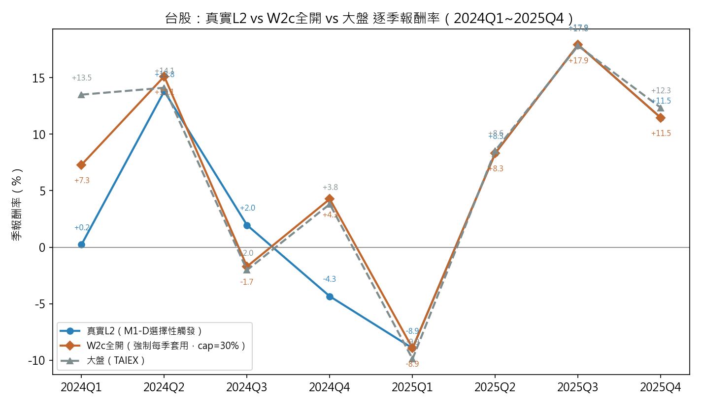
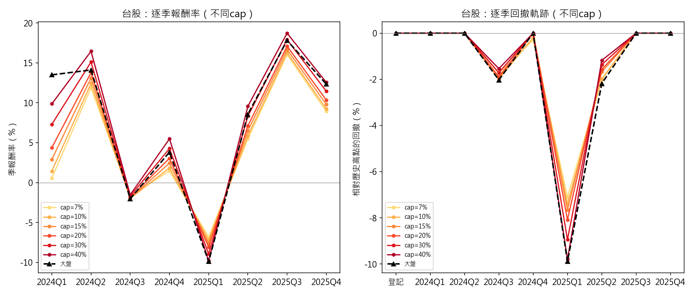
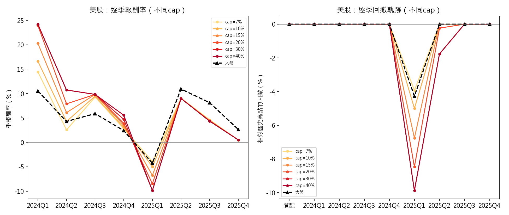

# 研究進度報告（2026-10-27）—實戰部結果

## 一、台股實戰層

30%單股上限、含M2策略群集中度監控、完整5條W2c caveat：

| 候選池 | control0 | L2 |
|---|---|---|
| baseline（含V1） | +11.16% | **+48.64%** |
| exclude_v1 | +14.44% | **+44.18%** |

## 二、美股實戰層

| 候選池 | control0 | L2 |
|---|---|---|
| baseline（含V1） | +91.10% | **+91.53%** |
| exclude_v1 | +105.61% | **+105.96%** |

美股window4（2024-2025）於2025年第三季出現集中度異常、M1-D監控觸發，agent啟動W2c修正動作。

## 三、跨市場（XM）混合結果

TW+US各50%資本權重混合（exclude_v1池）：

| | control0 | L2 |
|---|---|---|
| XM混合 | +56.29% | **+74.47%** |

## 四、風險端（MDD）對照

同一組9個季末點取樣，跟大盤同頻率比較：

| | L2 MDD | 大盤同期MDD |
|---|---|---|
| TW baseline | **-6.34%** | -9.89% |
| TW exclude_v1 | -12.91% | -9.89% |
| US baseline | -9.61% | -4.27% |
| US exclude_v1 | -10.89% | -4.27% |

**逐季軌跡**（圖3、圖4；9個季末點，登記＋8季）：兩市場全部回撤都集中在2025Q1同一季，其餘季度策略與大盤多半都在創新高、無回撤。

- 台股baseline：2024Q1（-0.79%）、2024Q4（-2.70%）小幅回撤後都創新高；2025Q1最深（-6.34%），比TAIEX同期（-9.89%）淺，隨即在2025Q2創新高——全程都比大盤淺。
- 台股exclude_v1：2024Q4（-4.35%）、2025Q1最深（-12.91%，**比TAIEX同期更深**）、2025Q2仍在回撤中（-5.65%，TAIEX同期已收斂到-2.18%）——是四組裡唯一一組逐季軌跡劣於大盤的。
- 美股baseline／exclude_v1：全程只有2024Q2（-2.43%／-2.92%，S&P500同期無回撤）跟2025Q1兩個回撤點，2025Q1兩者（-9.61%／-10.89%）都是S&P500同期（-4.27%）的2.2~2.5倍深，2025Q2起同步創新高。

## 五、台股策略跟不上大盤的原因

核心機制：策略池本質是等權配置（分散到500+檔股票），而TAIEX是市值加權指數、由台積電主導。當台積電漲幅遠超大盤平均時，等權策略結構上跟不上市值加權指數。

兩個落後最明顯的季度：

| 季度 | 策略報酬 | TAIEX | 落後 | 台積電當季報酬 |
|---|---|---|---|---|
| 2024Q1 | -0.79% | +13.50% | -14.29pp | **+27.8%**（約TAIEX的2倍） |
| 2024Q4 | -2.70% | +3.81% | -6.51pp | **+12.8%**（約TAIEX的3.3倍） |

驗證這是結構性、不是選股失敗：同樣這兩季，策略報酬其實緊貼台股全市場等權基準（2024Q1策略-0.79% vs 等權-0.09%，只差0.7pp；2024Q4策略-2.70% vs 等權-4.25%，策略還略勝1.55pp）——問題不在選股規則本身，是等權配置結構性地不會集中到台積電這種單一權值股的漲幅。

2025年後半段有改善：2025Q2~Q4，雖然台積電/大型股依舊強勢（TAIEX跟等權基準的缺口同樣有8~11pp），但策略報酬明顯超越等權基準（2025Q3策略+17.57% vs 等權+8.72%，贏8.85pp），縮小（但沒有完全追平）跟TAIEX的差距——顯示選股規則後期有抓到一部分這波漲勢，不是從頭到尾都跟不上。

## 六、美股策略跟不上大盤的原因

兩個落後季度的機制不完全相同：

**2024Q2（落後6.71pp）——跟台股同一種機制：少數巨頭漲幅遠超大盤，拉開市值加權指數**

| | 當季報酬 |
|---|---|
| 策略 | -2.43% |
| S&P500 | +4.28% |
| NVDA | **+36.7%** |
| AAPL | +23.0% |
| GOOGL | +20.8% |

策略報酬緊貼美股全市場等權基準（-2.43% vs -3.32%，策略還略勝0.89pp），問題在NVDA/AAPL/GOOGL這幾檔巨頭漲幅是大盤的5~9倍，把市值加權指數拉開，等權策略結構上跟不上。

**2025Q1（落後5.34pp）——不同機制：廣泛風險趨避賣壓，小型股跌幅比巨頭重**

| | 當季報酬 |
|---|---|
| 策略 | -9.61% |
| S&P500 | -4.27% |
| NVDA | -19.3% |
| AAPL | -11.2% |
| GOOGL | -18.2% |

這季巨頭本身也重挫（NVDA跌幅是大盤的4.5倍），但等權基準跌得更深（-8.90%），策略跟等權基準同樣接近（-9.61% vs -8.90%，只差0.71pp）——這是分散到數百檔股票的廣泛賣壓，不是少數巨頭獨漲的鏡像效果，兩季機制方向相反，不宜用同一套說法概括。

## 八、W2c單股上限敏感度分析（台美股，window4）

離線反事實測試（不呼叫LLM）：每季強制套用W2c市值加權（忽略M1-D真實觸發狀態），只改變單股上限，看報酬隨上限鬆緊怎麼變。exclude_v1候選池。

**台股**（對照TAIEX：累積+70.56%，同期MDD **-9.89%**）：

| 上限 | 8季累積報酬 | 超額 | MDD（季頻取樣） |
|---|---|---|---|
| 7% | +39.37% | -31.19pp | -7.10% |
| 10% | +42.03% | -28.53pp | -7.40% |
| 15% | +47.23% | -23.33pp | -7.66% |
| 20% | +52.70% | -17.86pp | -8.09% |
| 30% | +64.07% | -6.49pp | -8.95% |
| 40% | **+75.47%** | **+4.92pp（贏大盤）** | -9.80% |

**美股**（對照S&P500：累積+47.38%，同期MDD **-4.27%**）：

| 上限 | 8季累積報酬 | 超額 | MDD（季頻取樣） |
|---|---|---|---|
| 7% | +45.22% | -2.16pp | -3.93% |
| 10% | **+49.27%** | **+1.89pp（已贏大盤）** | -5.00% |
| 15% | +54.72% | +7.34pp | -6.76% |
| 20% | +59.71% | +12.33pp | -8.47% |
| 30% | +62.99% | +15.61pp | -9.88% |
| 40% | +64.29% | +16.91pp | -9.88% |

兩個市場曲線形狀不同：台股報酬隨上限放寬平滑上升、要到40%才贏大盤；美股只要10%就贏大盤，且20~30%之後報酬成長明顯趨緩（30%→40%只增加1.3pp，20%→30%增加3.28pp）。MDD則兩市場都隨上限放寬單調惡化（上限越鬆、持股越集中、回撤越深），美股30%→40%MDD持平（-9.88%兩者相同，代表那兩季的最大回撤已由同一檔重壓股主導、上限放寬到40%未再進一步加劇集中）；報酬跟風險呈同向抵換，上限放寬不是「免費的」報酬提升。

**跟大盤MDD比較**：台股所有上限等級的MDD（-7.10%~-9.80%）都優於TAIEX同期（-9.89%），連40%這個贏報酬的上限等級，風險還是略低於大盤。美股則相反：10%以上的上限MDD（-5.00%~-9.88%）全部劣於S&P500同期（-4.27%），代表美股策略要贏過大盤報酬，得承擔比大盤更深的回撤——跟台股「報酬風險雙贏」的情況不同，美股是用風險換報酬。

## 九、Coverage Tilt／RepSwap機制效果驗證（台美股，window4）

離線反事實測試：8季全程強制套用（不管Hot Segment有沒有真的觸發），不呼叫LLM。

| | TW累積 | US累積 |
|---|---|---|
| control0（不調整） | +14.44% | +105.61% |
| CoverageTilt強制 | +14.58%（+0.14pp） | +106.68%（+1.07pp） |
| RepSwap強制 | +13.93%（-0.51pp） | +105.10%（-0.51pp） |

兩個市場方向一致：CoverageTilt效果微幅正向、RepSwap效果微幅負向，量級都在1pp以內，屬null/微幅效果。

## 十、Active Share分析（台美股，真實L2持股）

量化投組持股跟大盤的差異程度（Cremers & Petajisto, 2009指標；0%＝完全複製大盤，100%＝完全不重疊）。用真實production checkpoint（m1dfix/m2_v2最終版）的實際持股計算，不是假設每季都套用W2c的情境。

| | control0（8季平均） | L2真實持股（8季平均） | 真的套用W2c那幾季的平均 |
|---|---|---|---|
| 台股 | 88.2%（84.5%~90.0%） | **75.8%**（40.3%~89.8%，3/8季套用） | 54.8%（46.2%/40.3%/77.8%） |
| 美股 | 96.2%（95.4%~96.5%） | **96.2%**（95.4%~96.5%，1/8季套用） | 96.4%（僅1季） |

台股8季裡只有3季真的套用W2c（一季決策延遲），8季平均因此被另外5季的等權持股拉淡（88.2%→75.8%，降12.4pp），但真的套用的那3季單獨看降幅明顯（平均54.8%，最低40.3%）。美股8季只有1季真的套用（籃子K=3傾斜），且基期股票宇宙遠大於台股（2,972檔 vs 1,775檔），8季平均幾乎看不出差異（96.2%→96.2%）——這跟§二「只有最後一季報酬受W2c影響」的N=1發現是同一件事的另一個面向。

## 十一、W2c機制效果上限（台股，真實L2 vs 強制全開）

真實L2只在M1-D真的觸發時才套用W2c（8季裡3季），屬選擇性介入。另外做一組「W2c全開」反事實：每季強制套用市值加權傾斜＋cap=30%（跟真實L2同一個cap），不經M1-D判斷，純機械式計算、不含M2群集中度監控、不呼叫LLM。

| | 8季累積報酬 |
|---|---|
| control0（不調整） | +14.44% |
| **真實L2**（M1-D選擇性觸發，3/8季套用W2c＋M2＋5條caveat） | **+44.18%** |
| **W2c全開**（每季強制套用，cap=30%，無M2／無agent判斷） | **+64.07%** |

排序 control0 < 真實L2 < W2c全開，顯示W2c機制本身的效果比agent實際用到的更強——目前agent偏保守（只在M1-D真的異常時才觸發），如果每季都套用，報酬還能再往上。

⚠️ **caveat**：+44.18%跟+64.07%的落差不能全部歸因於「觸發頻率」單一變數——「W2c全開」版本同時也拿掉了M2群集中度監控跟agent的其餘判斷，是兩個變數一起變動，不是乾淨的單一變數對照。「W2c全開」代表的是**機制本身的效果上限**，不是「如果agent更常觸發W2c會得到的確切數字」。

## 十二、圖表

**逐季型態**（圖9、圖10，顏色越深＝上限越鬆）：兩市場的cap排序在每一季都保持單調（上限越鬆、同方向的漲跌幅越大），不是只有累積數字單調，逐季也沒有例外季——這代表cap對報酬/風險的影響是持續性的結構效果，不是被少數極端季撐出來的假象。台股2025Q1（cap=7%時-7.10%、cap=40%時-9.80%，隨cap單調惡化）、美股2025Q1（cap=7%時-3.93%、cap=40%時-9.88%，同樣單調）都是全年最深的回撤季，且cap越鬆回撤越深，兩市場同步，顯示單股上限放寬的風險代價集中在同一個總經壓力季節發作，不是分散在不同時間點。

## 十三、逐季AI決策紀錄（台美股，四組production checkpoint）

agent每一季可以選的動作：**維持現狀**（不改變投組）、**觀察名單**（不動持股，但列入後續追蹤）、**人工覆核**（升級給人工判斷）、**市值傾斜**（唯一真的改變持股的動作，只在偵測到規模曝險異常時才能選）。

| 季度 | 台股baseline | 台股exclude_v1 | 美股baseline | 美股exclude_v1 |
|---|---|---|---|---|
| 2024Q1 | 人工覆核 | 人工覆核 | 維持現狀 | 人工覆核 |
| 2024Q2 | 觀察名單 | 人工覆核 | 人工覆核 | 人工覆核 |
| 2024Q3 | 觀察名單 | 維持現狀 | 維持現狀 | 維持現狀 |
| 2024Q4 | 人工覆核 | 市值傾斜（決策，未套用） | 市值傾斜（決策，未套用） | 維持現狀 |
| 2025Q1 | 市值傾斜（決策，未套用） | 市值傾斜（決策，未套用） | 人工覆核 | 人工覆核 |
| 2025Q2 | **市值傾斜（已套用）** | **市值傾斜（已套用）** | 觀察名單 | 人工覆核 |
| 2025Q3 | **市值傾斜（已套用）** | **市值傾斜（已套用）** | 市值傾斜（決策，未套用） | 市值傾斜（決策，未套用） |
| 2025Q4 | **市值傾斜（已套用）** | **市值傾斜（已套用）** | **市值傾斜（已套用）** | **市值傾斜（已套用）** |

⚠️ **「決策」跟「套用」是兩件事**：agent在某一季做出「市值傾斜」的決策後，因為一季的決策延遲，要到**下一季**才會真的反映在持股權重上（表中粗體＝這季持股已經受影響）。台股兩個候選池從2024Q4起就連續5季都決策「市值傾斜」，但只有後3季（2025Q2~Q4）真的套用；美股從觸發起決策了3次，只有最後1次（2025Q4）真的套用。這跟§十Active Share分析的「3/8季套用」「1/8季套用」是同一件事，只看「決策」欄會誤以為套用的季數更多。
