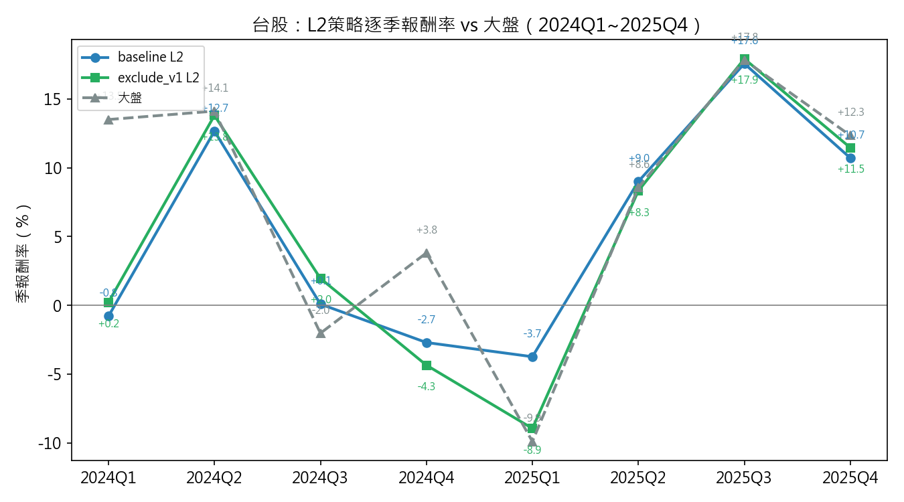
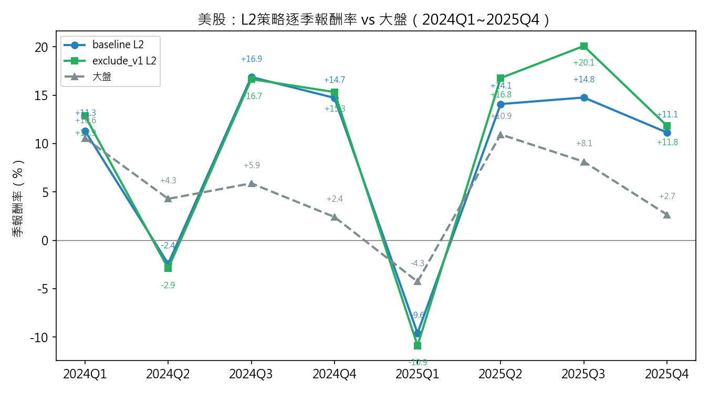
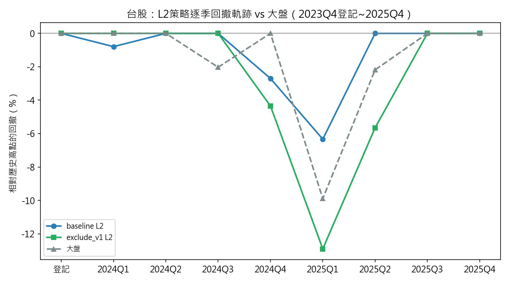
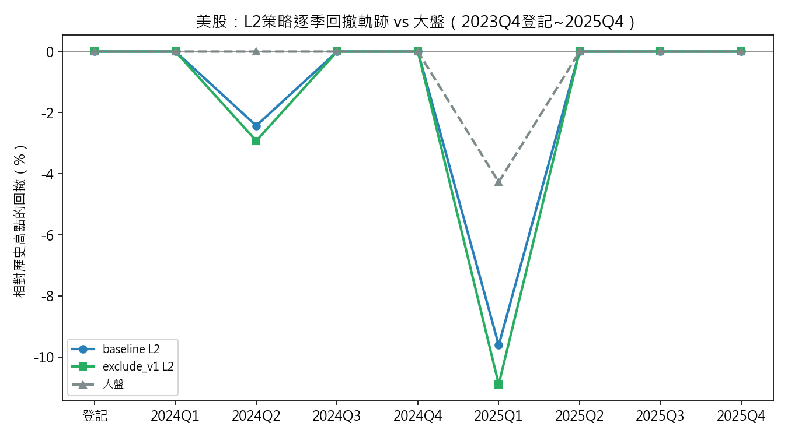
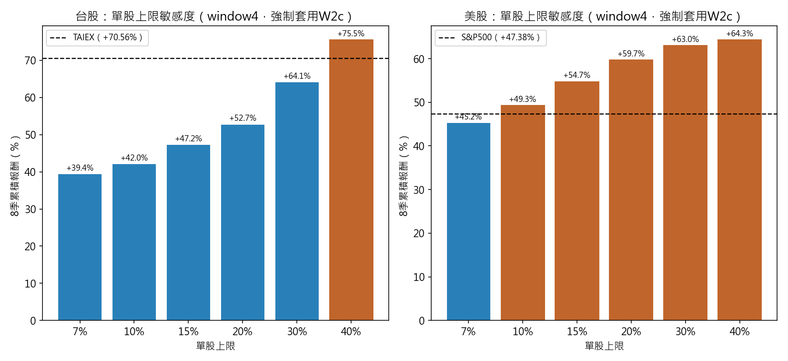
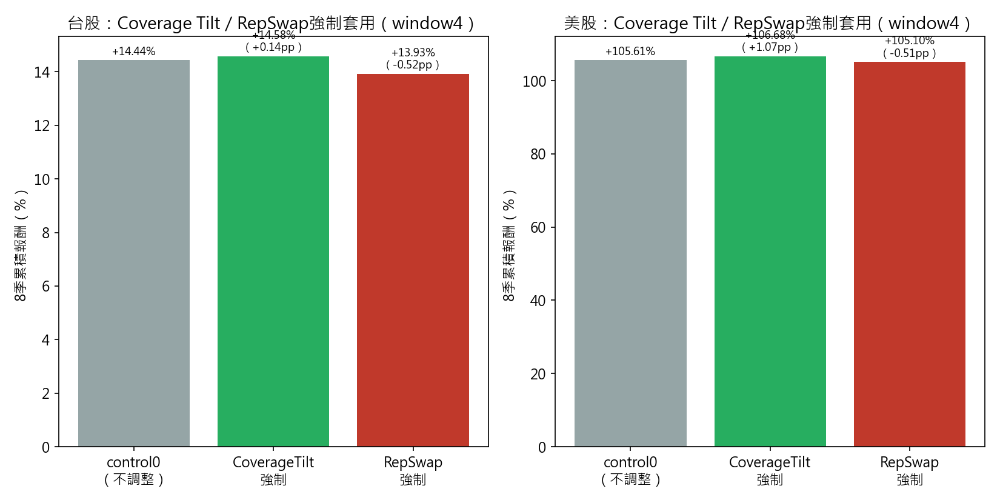
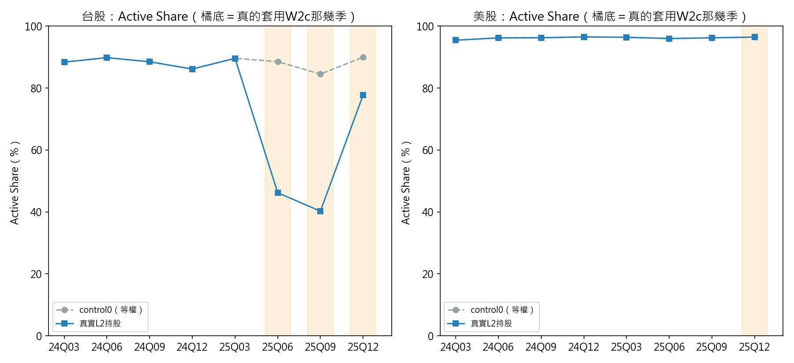

# 研究進度報告（2026-10-27）—實戰部結果

## 一、台股實戰層

30%單股上限、含M2策略群集中度監控、完整5條W2c caveat：

| 候選池 | control0 | L2 |
|---|---|---|
| baseline（含V1） | +11.16% | **+48.64%** |
| exclude_v1 | +14.44% | **+44.18%** |

## 二、美股實戰層

| 候選池 | control0 | L2 |
|---|---|---|
| baseline（含V1） | +91.10% | **+91.53%** |
| exclude_v1 | +105.61% | **+105.96%** |

美股window4（2024-2025）於2025年第三季出現集中度異常、M1-D監控觸發，agent啟動W2c修正動作。

## 三、跨市場（XM）混合結果

TW+US各50%資本權重混合（exclude_v1池）：

| | control0 | L2 |
|---|---|---|
| XM混合 | +56.29% | **+74.47%** |

## 四、風險端（MDD）對照

同一組9個季末點取樣，跟大盤同頻率比較：

| | L2 MDD | 大盤同期MDD |
|---|---|---|
| TW baseline | **-6.34%** | -9.89% |
| TW exclude_v1 | -12.91% | -9.89% |
| US baseline | -9.61% | -4.27% |
| US exclude_v1 | -10.89% | -4.27% |

## 五、台股策略跟不上大盤的原因

核心機制：策略池本質是等權配置（分散到500+檔股票），而TAIEX是市值加權指數、由台積電主導。當台積電漲幅遠超大盤平均時，等權策略結構上跟不上市值加權指數。

兩個落後最明顯的季度：

| 季度 | 策略報酬 | TAIEX | 落後 | 台積電當季報酬 |
|---|---|---|---|---|
| 2024Q1 | -0.79% | +13.50% | -14.29pp | **+27.8%**（約TAIEX的2倍） |
| 2024Q4 | -2.70% | +3.81% | -6.51pp | **+12.8%**（約TAIEX的3.3倍） |

驗證這是結構性、不是選股失敗：同樣這兩季，策略報酬其實緊貼台股全市場等權基準（2024Q1策略-0.79% vs 等權-0.09%，只差0.7pp；2024Q4策略-2.70% vs 等權-4.25%，策略還略勝1.55pp）——問題不在選股規則本身，是等權配置結構性地不會集中到台積電這種單一權值股的漲幅。

2025年後半段有改善：2025Q2~Q4，雖然台積電/大型股依舊強勢（TAIEX跟等權基準的缺口同樣有8~11pp），但策略報酬明顯超越等權基準（2025Q3策略+17.57% vs 等權+8.72%，贏8.85pp），縮小（但沒有完全追平）跟TAIEX的差距——顯示選股規則後期有抓到一部分這波漲勢，不是從頭到尾都跟不上。

## 六、美股策略跟不上大盤的原因

兩個落後季度的機制不完全相同：

**2024Q2（落後6.71pp）——跟台股同一種機制：少數巨頭漲幅遠超大盤，拉開市值加權指數**

| | 當季報酬 |
|---|---|
| 策略 | -2.43% |
| S&P500 | +4.28% |
| NVDA | **+36.7%** |
| AAPL | +23.0% |
| GOOGL | +20.8% |

策略報酬緊貼美股全市場等權基準（-2.43% vs -3.32%，策略還略勝0.89pp），問題在NVDA/AAPL/GOOGL這幾檔巨頭漲幅是大盤的5~9倍，把市值加權指數拉開，等權策略結構上跟不上。

**2025Q1（落後5.34pp）——不同機制：廣泛風險趨避賣壓，小型股跌幅比巨頭重**

| | 當季報酬 |
|---|---|
| 策略 | -9.61% |
| S&P500 | -4.27% |
| NVDA | -19.3% |
| AAPL | -11.2% |
| GOOGL | -18.2% |

這季巨頭本身也重挫（NVDA跌幅是大盤的4.5倍），但等權基準跌得更深（-8.90%），策略跟等權基準同樣接近（-9.61% vs -8.90%，只差0.71pp）——這是分散到數百檔股票的廣泛賣壓，不是少數巨頭獨漲的鏡像效果，兩季機制方向相反，不宜用同一套說法概括。

## 八、W2c單股上限敏感度分析（台美股，window4）

離線反事實測試（不呼叫LLM）：每季強制套用W2c市值加權（忽略M1-D真實觸發狀態），只改變單股上限，看報酬隨上限鬆緊怎麼變。exclude_v1候選池。

**台股**（對照TAIEX +70.56%）：

| 上限 | 8季累積報酬 | 超額 |
|---|---|---|
| 7% | +39.37% | -31.19pp |
| 10% | +42.03% | -28.53pp |
| 15% | +47.23% | -23.33pp |
| 20% | +52.70% | -17.86pp |
| 30% | +64.07% | -6.49pp |
| 40% | **+75.47%** | **+4.92pp（贏大盤）** |

**美股**（對照S&P500 +47.38%）：

| 上限 | 8季累積報酬 | 超額 |
|---|---|---|
| 7% | +45.22% | -2.16pp |
| 10% | **+49.27%** | **+1.89pp（已贏大盤）** |
| 15% | +54.72% | +7.34pp |
| 20% | +59.71% | +12.33pp |
| 30% | +62.99% | +15.61pp |
| 40% | +64.29% | +16.91pp |

兩個市場曲線形狀不同：台股報酬隨上限放寬平滑上升、要到40%才贏大盤；美股只要10%就贏大盤，且20~30%之後報酬成長明顯趨緩（30%→40%只增加1.3pp，20%→30%增加3.28pp）。

## 九、Coverage Tilt／RepSwap機制效果驗證（台美股，window4）

離線反事實測試：8季全程強制套用（不管Hot Segment有沒有真的觸發），不呼叫LLM。

| | TW累積 | US累積 |
|---|---|---|
| control0（不調整） | +14.44% | +105.61% |
| CoverageTilt強制 | +14.58%（+0.14pp） | +106.68%（+1.07pp） |
| RepSwap強制 | +13.93%（-0.51pp） | +105.10%（-0.51pp） |

兩個市場方向一致：CoverageTilt效果微幅正向、RepSwap效果微幅負向，量級都在1pp以內，屬null/微幅效果。

## 十、Active Share分析（台美股，真實L2持股）

量化投組持股跟大盤的差異程度（Cremers & Petajisto, 2009指標；0%＝完全複製大盤，100%＝完全不重疊）。用真實production checkpoint（m1dfix/m2_v2最終版）的實際持股計算，不是假設每季都套用W2c的情境。

| | control0（8季平均） | L2真實持股（8季平均） | 真的套用W2c那幾季的平均 |
|---|---|---|---|
| 台股 | 88.2%（84.5%~90.0%） | **75.8%**（40.3%~89.8%，3/8季套用） | 54.8%（46.2%/40.3%/77.8%） |
| 美股 | 96.2%（95.4%~96.5%） | **96.2%**（95.4%~96.5%，1/8季套用） | 96.4%（僅1季） |

台股8季裡只有3季真的套用W2c（一季決策延遲），8季平均因此被另外5季的等權持股拉淡（88.2%→75.8%，降12.4pp），但真的套用的那3季單獨看降幅明顯（平均54.8%，最低40.3%）。美股8季只有1季真的套用（籃子K=3傾斜），且基期股票宇宙遠大於台股（2,972檔 vs 1,775檔），8季平均幾乎看不出差異（96.2%→96.2%）——這跟§二「只有最後一季報酬受W2c影響」的N=1發現是同一件事的另一個面向。

## 十一、圖表

